<!-- Banner próprio em SVG animado, com a identidade do banner do LinkedIn (azul-marinho,
     dourado e azulejos à maneira de Athos Bulcão). Versões para celular e
     desktop, nos temas claro e escuro. Fonte: linkedin-banner/github.html. -->

  <picture>
    <source media="(max-width: 767px) and (prefers-color-scheme: dark)" srcset="https://raw.githubusercontent.com/IsaacGomes260653/IsaacGomes260653/main/assets/banner/banner-mobile-escuro.svg?v=7">
    <source media="(max-width: 767px)" srcset="https://raw.githubusercontent.com/IsaacGomes260653/IsaacGomes260653/main/assets/banner/banner-mobile-claro.svg?v=7">
    <source media="(prefers-color-scheme: dark)" srcset="https://raw.githubusercontent.com/IsaacGomes260653/IsaacGomes260653/main/assets/banner/banner-desktop-escuro.svg?v=7">
    
  </picture>

### 📍 Agora · Now

<!-- AGORA:INICIO -->
<!-- Gerado a partir do estudos.yml (campo agora). -->

  <a href="https://ilia.digital"><picture><source media="(prefers-color-scheme: dark)" srcset="https://raw.githubusercontent.com/IsaacGomes260653/IsaacGomes260653/main/assets/agora/card-1-escuro.svg?v=8c012379"></picture></a>
  <a href="https://isaacgomes260653.github.io/iris-pet-spa/"><picture><source media="(prefers-color-scheme: dark)" srcset="https://raw.githubusercontent.com/IsaacGomes260653/IsaacGomes260653/main/assets/agora/card-2-escuro.svg?v=fef199f6"></picture></a>
  <a href="https://github.com/IsaacGomes260653/estudos-dart"><picture><source media="(prefers-color-scheme: dark)" srcset="https://raw.githubusercontent.com/IsaacGomes260653/IsaacGomes260653/main/assets/agora/card-3-escuro.svg?v=b11797c8"></picture></a>

<!-- AGORA:FIM -->

<b>Atividade recente · Recent activity</b> (atualizada a cada 12h / updated every 12h)

<!-- ATIVIDADE:INICIO -->
<!-- Gerado pelo workflow atividade.yml a partir dos eventos públicos do GitHub. Não edite aqui. -->

- 🔀 **[feat: Íris no ar e perfil mais enxuto, leve e pontual](https://github.com/IsaacGomes260653/IsaacGomes260653/pull/38)** · [IsaacGomes260653](https://github.com/IsaacGomes260653/IsaacGomes260653) 
  PR mesclado · <em>Merged pull request</em> · 18/11/2026
- 📝 **[#39 Teste do painel de estudos (branch de teste, será fechada)](https://github.com/IsaacGomes260653/IsaacGomes260653/issues/39)** · [IsaacGomes260653](https://github.com/IsaacGomes260653/IsaacGomes260653) 
  Issue aberta · <em>Opened issue</em> · 18/11/2026
- 🔀 **[chore: links de código do roadmap seguem as pastas por etapa do estudos-dart](https://github.com/IsaacGomes260653/IsaacGomes260653/pull/41)** · [IsaacGomes260653](https://github.com/IsaacGomes260653/IsaacGomes260653) 
  PR mesclado · <em>Merged pull request</em> · 18/11/2026
- 🔀 **[refactor: estudos organizados em pastas por etapa do roadmap](https://github.com/IsaacGomes260653/estudos-dart/pull/6)** · [estudos-dart](https://github.com/IsaacGomes260653/estudos-dart) 
  PR mesclado · <em>Merged pull request</em> · 18/11/2026
- 🔀 **[feat: novo roadmap de estudos com Alura, dart.dev e Code With Andrea](https://github.com/IsaacGomes260653/IsaacGomes260653/pull/40)** · [IsaacGomes260653](https://github.com/IsaacGomes260653/IsaacGomes260653) 
  PR mesclado · <em>Merged pull request</em> · 18/11/2026
- ✅ **[#39 Teste do painel de estudos (branch de teste, será fechada)](https://github.com/IsaacGomes260653/IsaacGomes260653/issues/39)** · [IsaacGomes260653](https://github.com/IsaacGomes260653/IsaacGomes260653) 
  Issue fechada · <em>Closed issue</em> · 18/11/2026
- ⬆️ **[`feat/iris-no-ar`](https://github.com/IsaacGomes260653/IsaacGomes260653/commit/19145b10cad9a3098c32a3dc663e9062ba401e32)** · [IsaacGomes260653](https://github.com/IsaacGomes260653/IsaacGomes260653) 
  Commits enviados · <em>Pushed commits</em> · 13/11/2026
- 🔀 **[build: site estático publicado no GitHub Pages](https://github.com/IsaacGomes260653/iris-pet-spa/pull/5)** · [iris-pet-spa](https://github.com/IsaacGomes260653/iris-pet-spa) 
  PR mesclado · <em>Merged pull request</em> · 11/11/2026
<!-- ATIVIDADE:FIM -->

  <picture>
    <source media="(prefers-color-scheme: dark)" srcset="https://readme-typing-svg.demolab.com?font=Fira+Code&weight=500&size=22&duration=3000&pause=800&color=E8B84A&center=true&vCenter=true&width=620&lines=Troquei+planilhas+de+obra+por+um+app+offline;Swapped+job-site+sheets+for+an+offline+app;Estudando+Dart+rumo+ao+Flutter;Studying+Dart+on+the+road+to+Flutter">
    
  </picture>

  Estagiário na ília · Ciência da Computação no UniCEUB · Brasília, DF 
  <em>Intern at ília · Computer Science student at UniCEUB · Brasília, Brazil</em>

  
  

  <a href="#sobre-mim">Sobre&nbsp;/&nbsp;About</a> ·
  <a href="#agora">Agora&nbsp;/&nbsp;Now</a> ·
  <a href="#projetos">Projetos&nbsp;/&nbsp;Projects</a> ·
  <a href="#roadmap">Roadmap</a> ·
  <a href="#tech-stack">Stack</a> ·
  <a href="#certificados">Certificados&nbsp;/&nbsp;Certificates</a> ·
  <a href="#stats">Stats</a> ·
  <a href="#fun-corner">Fun&nbsp;corner</a> ·
  <a href="#contato">Contato&nbsp;/&nbsp;Contact</a>

---

### 👋 Sobre mim · About me

Estagiário na **ília** e estudante de Ciência da Computação no **UniCEUB**, em Brasília, com formatura prevista para dez/2028.\
Antes, na **GONAR Engenharia Civil**, criei o **RanchoControl**, um sistema offline que substituiu as planilhas de refeição e presença das obras.\
Gosto de construir a aplicação inteira, do banco de dados à interface, com testes e deploy.\
Português nativo · inglês avançado (Casa Thomas Jefferson).

<em>Intern at <b>ília</b> and Computer Science student at <b>UniCEUB</b> in Brasília, Brazil, graduating in Dec 2028. 
Before that, at <b>GONAR Engenharia Civil</b>, I built <b>RanchoControl</b>, an offline system that replaced the meal and attendance spreadsheets on the company's construction sites. 
I like building the whole application, from the database to the interface, with tests and deploy. 
Native Portuguese · advanced English (Casa Thomas Jefferson).</em>

---

<!-- Escrita à mão: nenhum workflow reescreve esta seção. Fica aberta por padrão,
     porque é a prova de trabalho; ao incluir ou tirar um projeto, atualize o número
     entre parênteses do título. -->

<b>📌 Projetos em destaque · Featured projects (7)</b>

#### 🎮 PlayHub · entregue / delivered

Portal de mini-jogos para a Mostra de Ciências do CEUB 2026: 7 jogos direto no navegador, instaláveis como app (PWA). 
<em>Mini-games portal for the CEUB 2026 Science Fair: 7 games right in the browser, installable as an app (PWA).</em>

<a href="https://isaacgomes260653.github.io/CEUB_CIENCIA_2026/">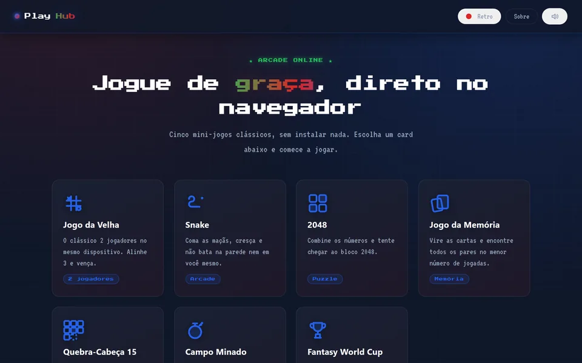</a>

  

[Repositório / Repository](https://github.com/IsaacGomes260653/CEUB_CIENCIA_2026) · [Jogar / Play](https://isaacgomes260653.github.io/CEUB_CIENCIA_2026/)

#### 🐾 Íris Pet Spa · no ar / live

Site de uma rede de petshop fictícia contado como um passeio em primeira pessoa, com rolagem cinematográfica e globo 3D das lojas. [Lighthouse 98 no desktop](https://github.com/IsaacGomes260653/iris-pet-spa#acessibilidade-e-desempenho). 
<em>Website for a fictional pet shop chain told as a first-person walk, with cinematic scrolling and a 3D globe of the stores. <a href="https://github.com/IsaacGomes260653/iris-pet-spa#acessibilidade-e-desempenho">Lighthouse 98 on desktop</a>.</em>

<a href="https://isaacgomes260653.github.io/iris-pet-spa/">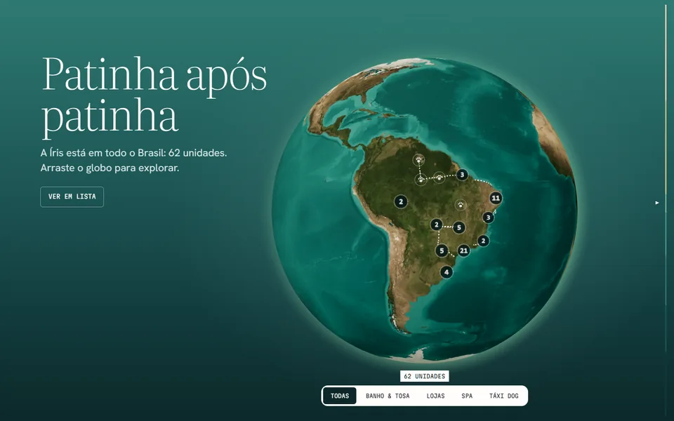</a>

   

[Repositório / Repository](https://github.com/IsaacGomes260653/iris-pet-spa) · [Abrir o site / Open the site](https://isaacgomes260653.github.io/iris-pet-spa/)

#### 🍽️ RanchoControl

Criado na GONAR para substituir as planilhas de controle de refeições e presença nas obras: funciona offline e exporta para Excel. 
<em>Built at GONAR to replace the meal and attendance spreadsheets on its construction sites: works offline and exports to Excel.</em>

<a href="https://github.com/IsaacGomes260653/Controle-de-Refeicao">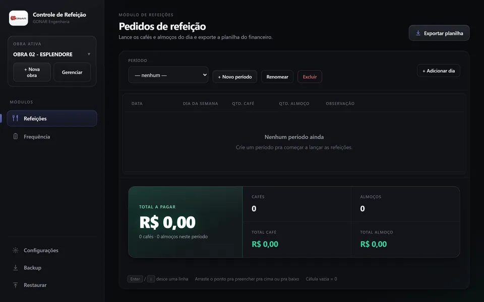</a>

  

[Repositório / Repository](https://github.com/IsaacGomes260653/Controle-de-Refeicao) · projeto interno, sem demo pública / internal project, no public demo

#### ✅ ForgetMeNot

Gerenciador de tarefas com integração a uma API pública, testes, CI/CD e deploy no Render. 
<em>Task manager with public API integration, tests, CI/CD, and a deploy on Render.</em>

<a href="https://forget-me-not-z9hy.onrender.com">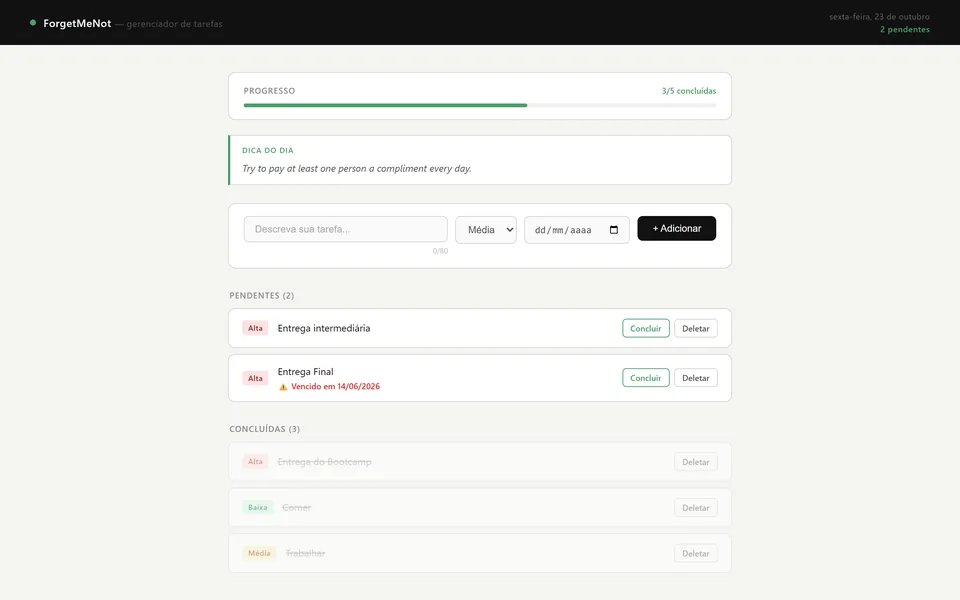</a>

   

[Repositório / Repository](https://github.com/IsaacGomes260653/forget_me_not) · [Demo](https://forget-me-not-z9hy.onrender.com) (pode levar ~40s para acordar / may take ~40s to wake up)

#### 📘 Estudos de Dart

Meus estudos de Dart rumo ao Flutter: um arquivo por assunto, com casos curtos e código comentado em português para rodar no DartPad. 
<em>My Dart studies on the road to Flutter: one file per topic, with short cases and commented code in Portuguese, ready to run in DartPad.</em>

 

[Repositório / Repository](https://github.com/IsaacGomes260653/estudos-dart) · [Dúvidas nas Discussions / Questions in Discussions](https://github.com/IsaacGomes260653/estudos-dart/discussions)

**Mais projetos · More projects**

- **[Álbum da Copa](https://github.com/IsaacGomes260653/Album-da-copa)**: álbum digital de figurinhas da Copa 2026 com as 992 figurinhas, multi-álbum e listas de repetidas e faltantes · [abrir / open](https://isaacgomes260653.github.io/Album-da-copa/) 
  <em>Digital sticker album for the 2026 World Cup with all 992 stickers, multi-album support, and duplicate and missing lists</em>
- **[TaskFlow](https://github.com/IsaacGomes260653/Sistema-de-Gerenciamento-de-Tarefas)**: CRUD de tarefas com login e controle de acesso por sessão, em PHP e MySQL 
  <em>Task CRUD with login and session-based access control, in PHP and MySQL</em>

---

### 🗺️ Roadmap de estudos · Study roadmap

<!-- ESTUDOS:INICIO -->
<!-- Gerado a partir do estudos.yml pelo workflow painel-estudos.yml. Não edite aqui: edite o estudos.yml. -->

✅ Concluído / Done · 🔄 Em andamento / In progress · ⬜ Pendente / To do

<picture>
  <source media="(max-width: 1199px) and (prefers-color-scheme: dark)" srcset="https://raw.githubusercontent.com/IsaacGomes260653/IsaacGomes260653/main/assets/estudos/flutter-celular-escuro.svg?v=43ba6b7a">
  <source media="(max-width: 1199px)" srcset="https://raw.githubusercontent.com/IsaacGomes260653/IsaacGomes260653/main/assets/estudos/flutter-celular-claro.svg?v=46725e37">
  <source media="(prefers-color-scheme: dark)" srcset="https://raw.githubusercontent.com/IsaacGomes260653/IsaacGomes260653/main/assets/estudos/flutter-escuro.svg?v=093d2f57">
  
</picture>

📍 **Agora / Now:** [`final` × `const` (canonicalização)](https://dart.dev/language/variables#final-and-const) · Variáveis e tipos · etapa 1 
<em>`final` × `const` (canonicalization) · Variables and types · stage 1</em>

✏️ <a href="https://github.com/IsaacGomes260653/IsaacGomes260653/issues/14">Atualizar progresso · Update progress</a>

<b>1 · Lógica e sintaxe · Logic and syntax</b> — 🔄 Em andamento / In progress · 5/47 ✅

Como o Dart funciona por dentro, variáveis e tipos, operadores, controle de fluxo, funções, coleções, os recursos do Dart 3, erros, ferramentas e testes desde o começo. 
<em>How Dart works under the hood, variables and types, operators, control flow, functions, collections, Dart 3 features, errors, tooling, and tests from day one.</em>

**Progresso / Progress:** `█░░░░░░░░░` 11% · 5/47 ✅

🔄 <b>Como o Dart funciona · How Dart works</b> · 1/4

- ✅ [JIT × AOT: debug com hot reload × release · JIT × AOT: debug with hot reload × release](https://dart.dev/overview#native-platform)
- ⬜ [O formato kernel e a Dart VM · The kernel format and the Dart VM](https://dart.dev/overview#platform)
- ⬜ [Garbage collector](https://dart.dev/overview#runtime)
- ⬜ [Sound null safety](https://dart.dev/null-safety)

🔄 <b>Variáveis e tipos · Variables and types</b> · 4/10 · <a href="https://github.com/IsaacGomes260653/estudos-dart/tree/main/01-logica-e-sintaxe/variaveis-e-tipos">código / code</a>

- ⬜ [`var` e inferência de tipo · `var` and type inference](https://dart.dev/language/variables) · [código / code](https://github.com/IsaacGomes260653/estudos-dart/blob/main/01-logica-e-sintaxe/variaveis-e-tipos/CriandoVariaveis.dart)
- ⬜ [`dynamic` × `Object?`](https://dart.dev/language/type-system)
- ✅ [Null safety](https://dart.dev/language/variables#null-safety) · [código / code](https://github.com/IsaacGomes260653/estudos-dart/blob/main/01-logica-e-sintaxe/variaveis-e-tipos/NullSafety.dart)
- ✅ [Valor padrão · Default value](https://dart.dev/language/variables#default-value) · [código / code](https://github.com/IsaacGomes260653/estudos-dart/blob/main/01-logica-e-sintaxe/variaveis-e-tipos/DefaultValue.dart)
- ✅ [`late`](https://dart.dev/language/variables#late-variables) · [código / code](https://github.com/IsaacGomes260653/estudos-dart/blob/main/01-logica-e-sintaxe/variaveis-e-tipos/LateVariables.dart)
- 🔄 **[`final` × `const` (canonicalização) · `final` × `const` (canonicalization)](https://dart.dev/language/variables#final-and-const)** · [código / code](https://github.com/IsaacGomes260653/estudos-dart/blob/main/01-logica-e-sintaxe/variaveis-e-tipos/FinalAndConst.dart)
- ✅ [`int` e `double` (`/` × `~/`) · `int` and `double` (`/` × `~/`)](https://dart.dev/language/built-in-types#numbers) · [código / code](https://github.com/IsaacGomes260653/estudos-dart/blob/main/01-logica-e-sintaxe/variaveis-e-tipos/Numbers.dart)
- ⬜ [`String`: interpolação, imutabilidade e `StringBuffer` · `String`: interpolation, immutability, and `StringBuffer`](https://dart.dev/language/built-in-types#strings)
- ⬜ [`bool`](https://dart.dev/language/built-in-types#booleans)
- ⬜ [Igualdade: `==` × `identical` · Equality: `==` × `identical`](https://dart.dev/language/operators#equality-and-relational-operators)

⬜ <b>Operadores · Operators</b> · 0/6

- ⬜ [Aritméticos · Arithmetic](https://dart.dev/language/operators#arithmetic-operators)
- ⬜ [De comparação · Comparison](https://dart.dev/language/operators#equality-and-relational-operators)
- ⬜ [Lógicos · Logical](https://dart.dev/language/operators#logical-operators)
- ⬜ [Null-aware: `?.`, `??`, `??=` e `!` · Null-aware: `?.`, `??`, `??=`, and `!`](https://dart.dev/language/operators#other-operators)
- ⬜ [Cascade (`..`)](https://dart.dev/language/operators#cascade-notation)
- ⬜ [`is` e `as` · `is` and `as`](https://dart.dev/language/operators#type-test-operators)

⬜ <b>Controle de fluxo · Control flow</b> · 0/5

- ⬜ [`if`/`else`](https://dart.dev/language/branches#if)
- ⬜ [`switch` statement e switch expression · `switch` statements and expressions](https://dart.dev/language/branches#switch-statements)
- ⬜ [`for` e `for-in` · `for` and `for-in`](https://dart.dev/language/loops#for-loops)
- ⬜ [`while` e `do-while` · `while` and `do-while`](https://dart.dev/language/loops#while-and-do-while)
- ⬜ [`break` e `continue` · `break` and `continue`](https://dart.dev/language/loops#break-and-continue)

⬜ <b>Funções · Functions</b> · 0/5

- ⬜ [Parâmetros posicionais, nomeados, opcionais e `required` · Positional, named, optional, and `required` parameters](https://dart.dev/language/functions#parameters)
- ⬜ [Arrow functions](https://dart.dev/language/functions)
- ⬜ [Funções anônimas · Anonymous functions](https://dart.dev/language/functions#anonymous-functions)
- ⬜ [Funções como valores · Functions as values](https://dart.dev/language/functions#functions-as-first-class-objects)
- ⬜ [Closures](https://dart.dev/language/functions#lexical-closures)

⬜ <b>Coleções a fundo · Collections in depth</b> · 0/4

- ⬜ [`List`, `Set` e `Map`: quando usar cada uma e o custo das operações · `List`, `Set`, and `Map`: when to use each and what operations cost](https://dart.dev/language/collections)
- ⬜ [`Iterable` lazy · Lazy `Iterable`](https://dart.dev/libraries/collections/iterables)
- ⬜ [`map`, `where`, `fold`, `reduce`, `expand`, `any`, `every` e `sort` · `map`, `where`, `fold`, `reduce`, `expand`, `any`, `every`, and `sort`](https://dart.dev/libraries/collections/iterables)
- ⬜ [Collection `if`/`for`, spread e null-aware elements · Collection `if`/`for`, spread, and null-aware elements](https://dart.dev/language/collections#collection-elements)

⬜ <b>Dart 3</b> · 0/4

- ⬜ [Records](https://dart.dev/language/records)
- ⬜ [Patterns: desestruturação, `if-case` e `switch` exaustivo · Patterns: destructuring, `if-case`, and exhaustive `switch`](https://dart.dev/language/patterns)
- ⬜ [Enums com campos · Enums with fields](https://dart.dev/language/enums#declaring-enhanced-enums)
- ⬜ [Dot shorthands](https://dart.dev/language/dot-shorthands)

⬜ <b>Erros básicos · Error basics</b> · 0/2

- ⬜ [`try`, `catch`, `on`, `finally` e `rethrow` · `try`, `catch`, `on`, `finally`, and `rethrow`](https://dart.dev/language/error-handling)
- ⬜ [`Exception` × `Error`](https://dart.dev/language/error-handling)

⬜ <b>Ferramentas · Tooling</b> · 0/3

- ⬜ [`pubspec.yaml`, pub.dev e imports · `pubspec.yaml`, pub.dev, and imports](https://dart.dev/tools/pub/pubspec)
- ⬜ [`dart analyze` e `dart format` · `dart analyze` and `dart format`](https://dart.dev/tools/dart-analyze)
- ⬜ [Lints e Effective Dart · Lints and Effective Dart](https://dart.dev/effective-dart)

⬜ <b>Testes desde já · Tests from day one</b> · 0/1

- ⬜ [`package:test`: `test`, `expect`, `group` e `setUp` · `package:test`: `test`, `expect`, `group`, and `setUp`](https://dart.dev/tools/testing)

⬜ <b>🏁 Checkpoint</b> · 0/3

- ⬜ Explicar JIT/AOT e `final`/`const` em 30 s · Explain JIT/AOT and `final`/`const` in 30 s
- ⬜ Prever a saída de 10 trechos de código · Predict the output of 10 code snippets
- ⬜ Escrever do zero uma calculadora de notas com records e testes · Write a grade calculator from scratch, with records and tests

**Onde / Where:** [Alura · Formação Dart](https://www.alura.com.br/formacao-dart) · [Dart: trabalhando com a sintaxe e configuração de projeto](https://www.alura.com.br/curso-online-dart-trabalhando-sintaxe-configuracao-projeto) · [Praticando Collections no Dart](https://www.alura.com.br/curso-online-praticando-collections-dart-listas-sets-mapas) · [dart.dev · Language](https://dart.dev/language) · [Effective Dart](https://dart.dev/effective-dart) · [DartPad](https://dartpad.dev)

<b>2 · Programação orientada a objetos · Object-oriented programming</b> — ⬜ Pendente / To do · 0/27

Classes e construtores, encapsulamento e imutabilidade, herança e composição, interfaces e mixins, class modifiers, generics e extensions, com SOLID por trás de tudo. 
<em>Classes and constructors, encapsulation and immutability, inheritance and composition, interfaces and mixins, class modifiers, generics, and extensions, with SOLID behind it all.</em>

**Progresso / Progress:** `░░░░░░░░░░` 0% · 0/27

⬜ <b>Classes e objetos · Classes and objects</b> · 0/3

- ⬜ [Classes, objetos e `this` · Classes, objects, and `this`](https://dart.dev/language/classes)
- ⬜ [Membros `static` · `static` members](https://dart.dev/language/classes#class-variables-and-methods)
- ⬜ O objeto na memória · The object in memory

⬜ <b>Construtores · Constructors</b> · 0/5

- ⬜ [Padrão e nomeados · Default and named](https://dart.dev/language/constructors#named-constructors)
- ⬜ [Lista de inicialização · Initializer list](https://dart.dev/language/constructors#use-an-initializer-list)
- ⬜ [Redirecionadores · Redirecting](https://dart.dev/language/constructors#redirecting-constructors)
- ⬜ [`factory`](https://dart.dev/language/constructors#factory-constructors)
- ⬜ [`const`](https://dart.dev/language/constructors#constant-constructors)

⬜ <b>Encapsulamento e imutabilidade · Encapsulation and immutability</b> · 0/3

- ⬜ [Privacidade com `_`, getters e setters · Privacy with `_`, getters, and setters](https://dart.dev/language/methods#getters-and-setters)
- ⬜ Imutabilidade e `copyWith` · Immutability and `copyWith`
- ⬜ `==` e `hashCode`, sempre juntos · `==` and `hashCode`, always together

⬜ <b>Herança · Inheritance</b> · 0/3

- ⬜ [`extends`, `super` e `@override` · `extends`, `super`, and `@override`](https://dart.dev/language/extend)
- ⬜ Polimorfismo · Polymorphism
- ⬜ Composição × herança · Composition × inheritance

⬜ <b>Abstração · Abstraction</b> · 0/3

- ⬜ [Classes abstratas · Abstract classes](https://dart.dev/language/class-modifiers#abstract)
- ⬜ [Interfaces com `implements` · Interfaces with `implements`](https://dart.dev/language/classes#implicit-interfaces)
- ⬜ [Mixins: `with`, `on` e a ordem de linearização · Mixins: `with`, `on`, and linearization order](https://dart.dev/language/mixins)

⬜ <b>Class modifiers</b> · 0/2

- ⬜ [`sealed`, `final`, `base` e `interface` · `sealed`, `final`, `base`, and `interface`](https://dart.dev/language/class-modifiers)
- ⬜ [`sealed` com `switch` exaustivo para estados de tela · `sealed` with exhaustive `switch` for screen states](https://dart.dev/language/class-modifiers#sealed)

⬜ <b>Tipos e extensões · Types and extensions</b> · 0/4

- ⬜ [Enums avançados · Enhanced enums](https://dart.dev/language/enums)
- ⬜ [Generics: `T extends` e um tipo `Result<T>` · Generics: `T extends` and a `Result<T>` type](https://dart.dev/language/generics)
- ⬜ [Extension methods](https://dart.dev/language/extension-methods)
- ⬜ Exceções personalizadas do domínio · Custom domain exceptions

⬜ <b>Design</b> · 0/2

- ⬜ SOLID
- ⬜ Coesão e acoplamento · Cohesion and coupling

⬜ <b>🏁 Checkpoint</b> · 0/2

- ⬜ Explicar `extends` × `implements` × `with` · Explain `extends` × `implements` × `with`
- ⬜ Modelar do zero `Conta`, `Transacao` e `StatusPagamento` (sealed), com testes · Model `Conta`, `Transacao`, and `StatusPagamento` (sealed) from scratch, with tests

**Onde / Where:** [Alura · Formação Dart](https://www.alura.com.br/formacao-dart) · [Dart: trabalhando com orientação a objetos](https://www.alura.com.br/curso-online-dart-trabalhando-orientacao-objetos) · [Praticando Collections no Dart](https://www.alura.com.br/curso-online-praticando-collections-dart-listas-sets-mapas) · [dart.dev · Classes](https://dart.dev/language/classes) · [dart.dev · Class modifiers](https://dart.dev/language/class-modifiers)

<b>3 · Assincronismo e APIs · Async and APIs</b> — ⬜ Pendente / To do · 0/15

Event loop, Future e async/await, Stream, HTTP e JSON, isolates e testes assíncronos com mocks. 
<em>Event loop, Future and async/await, Stream, HTTP and JSON, isolates, and async tests with mocks.</em>

**Progresso / Progress:** `░░░░░░░░░░` 0% · 0/15

⬜ <b>Event loop</b> · 0/2

- ⬜ [Uma thread só · A single thread](https://dart.dev/language/concurrency#event-loop)
- ⬜ [Microtask queue × event queue](https://dart.dev/language/concurrency)

⬜ <b>Future</b> · 0/3

- ⬜ [Estados, `then` e `catchError` · States, `then`, and `catchError`](https://dart.dev/libraries/async/async-await)
- ⬜ `Future.wait` e timeouts · `Future.wait` and timeouts
- ⬜ [`async`/`await`: o que o compilador faz e os erros comuns · `async`/`await`: what the compiler does and common mistakes](https://dart.dev/libraries/async/async-await)

⬜ <b>Stream</b> · 0/4

- ⬜ [Single-subscription × broadcast](https://dart.dev/libraries/async/using-streams)
- ⬜ [`async*`/`yield`](https://dart.dev/libraries/async/creating-streams)
- ⬜ [`StreamController` e transformações · `StreamController` and transformations](https://dart.dev/libraries/async/creating-streams)
- ⬜ [Erros assíncronos · Async errors](https://dart.dev/libraries/async/using-streams)

⬜ <b>HTTP e JSON · HTTP and JSON</b> · 0/2

- ⬜ [`package:http`: GET, POST, headers, status codes e token · `package:http`: GET, POST, headers, status codes, and tokens](https://dart.dev/server/fetch-data)
- ⬜ [JSON: `jsonDecode`, `fromJson`/`toJson` e camada de modelo · JSON: `jsonDecode`, `fromJson`/`toJson`, and a model layer](https://dart.dev/libraries/serialization/json)

⬜ <b>Isolates e testes · Isolates and tests</b> · 0/2

- ⬜ [Isolates: memória isolada e `Isolate.run` · Isolates: isolated memory and `Isolate.run`](https://dart.dev/language/isolates)
- ⬜ [Testes assíncronos com mocks · Async tests with mocks](https://dart.dev/tools/testing)

⬜ <b>🏁 Checkpoint</b> · 0/2

- ⬜ Prever a ordem dos prints com Future, microtask e Timer · Predict the print order with Future, microtask, and Timer
- ⬜ Criar um cliente de API com tratamento de erros e testes · Build an API client with error handling and tests

**Onde / Where:** [Dart: lidando com erros, exceções e null safety](https://www.alura.com.br/curso-online-dart-lidando-erros-excecoes-null-safety) · [Dart: dominando assincronismo e criando comunicação com APIs](https://www.alura.com.br/curso-online-dart-dominando-assincronismo-criando-comunicacao-apis) · [dart.dev · Asynchronous programming](https://dart.dev/libraries/async/async-await) · [dart.dev · Concurrency](https://dart.dev/language/concurrency)

<b>4 · Projeto prático · Hands-on project</b> — ⬜ Pendente / To do · 0/10

Gerenciador de tarefas de console, publicado no GitHub. 
<em>Console task manager, published on GitHub.</em>

**Progresso / Progress:** `░░░░░░░░░░` 0% · 0/10

⬜ <b>Modelo · Model</b> · 0/2

- ⬜ Classe `Tarefa` imutável, com prioridade (enum) e status (sealed) · Immutable `Tarefa` (task) class, with priority (enum) and status (sealed)
- ⬜ Adicionar, listar, filtrar, concluir e remover · Add, list, filter, complete, and remove

⬜ <b>Camadas · Layers</b> · 0/3

- ⬜ Modelo → repositório → serviço → console · Model → repository → service → console
- ⬜ Persistência em JSON assíncrona · Async JSON persistence
- ⬜ Exceções do domínio · Domain exceptions

⬜ <b>Qualidade e fluxo de trabalho · Quality and workflow</b> · 0/4

- ⬜ TDD com mais de 80% de cobertura · TDD with over 80% coverage
- ⬜ `dart analyze` sem avisos · `dart analyze` with no warnings
- ⬜ README com prints · README with screenshots
- ⬜ Branch por funcionalidade, pull requests e issues · Feature branches, pull requests, and issues

⬜ <b>🏁 Checkpoint</b> · 0/1

- ⬜ Apresentar o projeto em 2 minutos, explicando as decisões · Present the project in 2 minutes, explaining the decisions

**Onde / Where:** [dart.dev · Testing](https://dart.dev/tools/testing)

<b>5 · Flutter</b> — ⬜ Pendente / To do · 0/28

As três árvores, layout, interface e navegação, estado e arquitetura, dados e testes, performance e release até as lojas. 
<em>The three trees, layout, UI and navigation, state and architecture, data and tests, performance, and release to the stores.</em>

**Progresso / Progress:** `░░░░░░░░░░` 0% · 0/28

⬜ <b>Fundamentos · Fundamentals</b> · 0/3

- ⬜ As três árvores: Widget, Element e RenderObject · The three trees: Widget, Element, and RenderObject
- ⬜ Stateless × Stateful e o ciclo de vida do State · Stateless × Stateful and the State lifecycle
- ⬜ `BuildContext` e Keys · `BuildContext` and Keys

⬜ <b>Layout</b> · 0/4

- ⬜ Constraints go down, sizes go up
- ⬜ `Row`, `Column`, `Stack` e `Expanded` · `Row`, `Column`, `Stack`, and `Expanded`
- ⬜ Listas · Lists
- ⬜ Responsividade · Responsiveness

⬜ <b>Interface e navegação · UI and navigation</b> · 0/4

- ⬜ Material 3 e temas · Material 3 and themes
- ⬜ Formulários com validação · Forms with validation
- ⬜ Acessibilidade · Accessibility
- ⬜ go_router e deep links · go_router and deep links

⬜ <b>Estado e arquitetura · State and architecture</b> · 0/4

- ⬜ `setState`, `ValueNotifier` e `InheritedWidget` · `setState`, `ValueNotifier`, and `InheritedWidget`
- ⬜ O pacote de estado que a Koin usa · The state package Koin uses
- ⬜ Arquitetura oficial do Flutter: MVVM e camadas · Flutter's official architecture: MVVM and layers
- ⬜ Injeção de dependência · Dependency injection

⬜ <b>Dados e testes · Data and tests</b> · 0/4

- ⬜ APIs, cache e persistência local · APIs, caching, and local persistence
- ⬜ Testes unitários e de widget · Unit and widget tests
- ⬜ Golden tests
- ⬜ `integration_test` e Maestro · `integration_test` and Maestro

⬜ <b>Performance e release · Performance and release</b> · 0/5

- ⬜ DevTools, rebuilds e const widgets · DevTools, rebuilds, and const widgets
- ⬜ Flavors e assinatura · Flavors and signing
- ⬜ CI/CD
- ⬜ Monitoramento de erros · Error monitoring
- ⬜ Publicação nas lojas · Publishing to the stores

⬜ <b>🏁 Entregáveis · 🏁 Deliverables</b> · 0/4

- ⬜ O gerenciador de tarefas virando app Flutter · The task manager as a Flutter app
- ⬜ Um app consumindo uma API real · An app consuming a real API
- ⬜ Certificados da Alura · Alura certificates
- ⬜ Certificados do Code With Andrea · Code With Andrea certificates

**Onde / Where:** [Alura · Formação Flutter by Nubank](https://www.alura.com.br/carreiras/desenvolvimento-mobile-com-flutter) · [Code With Andrea · Flutter Foundations](https://codewithandrea.com/courses/flutter-foundations/) (US$ 99) · [Code With Andrea · Flutter in Production](https://codewithandrea.com/courses/flutter-in-production/) (US$ 79 a US$ 119)

#### Em paralelo: credenciais e ferramentas do trabalho · In parallel: work credentials and tools

<b>Jira Fundamentals</b> — ⬜ Pendente / To do · 0/4

Selo da Atlassian University, grátis. 
<em>Atlassian University badge, free.</em>

**Progresso / Progress:** `░░░░░░░░░░` 0% · 0/4

- ⬜ [Get started quickly with Jira](https://community.atlassian.com/learning/path/get-the-most-out-of-jira/course/get-started-with-jira)
- ⬜ [Track your work effectively in Jira](https://community.atlassian.com/learning/path/get-the-most-out-of-jira/course/track-your-work-effectively-in-jira)
- ⬜ [Personalize how you work in Jira](https://community.atlassian.com/learning/path/get-the-most-out-of-jira/course/jira-dashboard-training)
- ⬜ Selo Jira Fundamentals · Jira Fundamentals badge

**Onde / Where:** [Atlassian University · Jira](https://community.atlassian.com/learning/path/get-the-most-out-of-jira) (gratuito / free)

<b>GitHub Foundations (GH-900)</b> — ⬜ Pendente / To do · 0/3

Certificação oficial do GitHub, estudada pelo Microsoft Learn. 
<em>Official GitHub certification, studied on Microsoft Learn.</em>

**Progresso / Progress:** `░░░░░░░░░░` 0% · 0/3

- ⬜ [GitHub Foundations Part 1](https://learn.microsoft.com/en-us/training/paths/github-foundations/)
- ⬜ [GitHub Foundations Part 2](https://learn.microsoft.com/en-us/training/paths/github-foundations-2/)
- ⬜ [Exame GH-900 · GH-900 exam](https://learn.microsoft.com/en-us/credentials/certifications/github-foundations/)

**Onde / Where:** [Microsoft Learn · GitHub](https://learn.microsoft.com/en-us/training/github/) · [GitHub Foundations](https://learn.microsoft.com/en-us/credentials/certifications/github-foundations/) (grátis para estudante / free for students)

<b>PSM I</b> — ⬜ Pendente / To do · 0/3

Certificação oficial da Scrum.org. 
<em>Official Scrum.org certification.</em>

**Progresso / Progress:** `░░░░░░░░░░` 0% · 0/3

- ⬜ [Scrum Guide 2020](https://scrumguides.org/scrum-guide.html)
- ⬜ [Scrum Open até acertar 100% · Scrum Open until I score 100%](https://www.scrum.org/open-assessments/scrum-open)
- ⬜ [Exame PSM I · PSM I exam](https://www.scrum.org/assessments/professional-scrum-master-i-certification)

**Onde / Where:** [Scrum Guide](https://scrumguides.org/scrum-guide.html) · [Scrum Open](https://www.scrum.org/open-assessments/scrum-open) (gratuito / free) · [PSM I](https://www.scrum.org/assessments/professional-scrum-master-i-certification)

<b>Git a fundo · Git in depth</b> — ⬜ Pendente / To do · 0/9

Como o Git funciona por dentro e o fluxo de trabalho no GitHub. 
<em>How Git works inside, and the GitHub workflow.</em>

**Progresso / Progress:** `░░░░░░░░░░` 0% · 0/9

- ⬜ [Objetos: blob, tree e commit · Objects: blob, tree, and commit](https://git-scm.com/book/en/v2/Git-Internals-Git-Objects)
- ⬜ [Merge × rebase](https://git-scm.com/book/en/v2/Git-Branching-Rebasing)
- ⬜ [Conflitos · Conflicts](https://git-scm.com/book/en/v2/Git-Branching-Basic-Branching-and-Merging)
- ⬜ [Reset × revert](https://git-scm.com/book/en/v2/Git-Tools-Reset-Demystified)
- ⬜ Cherry-pick e stash · Cherry-pick and stash
- ⬜ [Tags e Conventional Commits · Tags and Conventional Commits](https://www.conventionalcommits.org/pt-br/v1.0.0/)
- ⬜ GitHub: pull requests e Projects · GitHub: pull requests and Projects
- ⬜ GitHub Actions
- ⬜ Dependabot e Copilot · Dependabot and Copilot

**Onde / Where:** [Pro Git](https://git-scm.com/book/en/v2) · [Conventional Commits](https://www.conventionalcommits.org/pt-br/v1.0.0/)

<b>Scrum e Kanban · Scrum and Kanban</b> — ⬜ Pendente / To do · 0/7

Os fundamentos dos dois e como tudo isso aparece no Jira. 
<em>The basics of both, and how it all shows up in Jira.</em>

**Progresso / Progress:** `░░░░░░░░░░` 0% · 0/7

- ⬜ [Empirismo e valores · Empiricism and values](https://scrumguides.org/scrum-guide.html#scrum-theory)
- ⬜ [Responsabilidades · Accountabilities](https://scrumguides.org/scrum-guide.html#scrum-team)
- ⬜ [Eventos · Events](https://scrumguides.org/scrum-guide.html#scrum-events)
- ⬜ [Artefatos · Artifacts](https://scrumguides.org/scrum-guide.html#scrum-artifacts)
- ⬜ [WIP limits](https://www.atlassian.com/agile/kanban/wip-limits)
- ⬜ Lead time e cycle time · Lead time and cycle time
- ⬜ Tudo isso no Jira · All of it in Jira

**Onde / Where:** [Scrum Guide](https://scrumguides.org/scrum-guide.html) · [Atlassian Agile Coach · Kanban](https://www.atlassian.com/agile/kanban)

#### Trilhas futuras · Future tracks

<b>IA · AI</b> — ⬜ Pendente / To do · 0/1

Com a certificação oficial. 
<em>With the official certification.</em>

**Progresso / Progress:** `░░░░░░░░░░` 0% · 0/1

- ⬜ Certificação oficial · Official certification

<b>Databricks</b> — ⬜ Pendente / To do · 0/3

Retomar o curso que comecei e fazer a certificação oficial. 
<em>Pick back up the course I started and take the official certification.</em>

**Progresso / Progress:** `░░░░░░░░░░` 0% · 0/3

- ⬜ [Databricks Fundamentals](https://www.databricks.com/training/catalog/databricks-fundamentals-2206)
- ⬜ [Prática na Free Edition · Hands-on in the Free Edition](https://www.databricks.com/learn/free-edition)
- ⬜ [Certificação Data Engineer Associate · Data Engineer Associate certification](https://www.databricks.com/learn/certification/data-engineer-associate)

**Onde / Where:** [Databricks Academy](https://www.databricks.com/learn/training/home) (gratuito / free) · [Databricks Free Edition](https://www.databricks.com/learn/free-edition) (gratuito / free) · [Data Engineer Associate](https://www.databricks.com/learn/certification/data-engineer-associate) (US$ 200)

<b>AWS</b> — ⬜ Pendente / To do · 0/14

Fundamentos de nuvem na AWS, com a certificação oficial. 
<em>AWS cloud fundamentals, with the official certification.</em>

**Progresso / Progress:** `░░░░░░░░░░` 0% · 0/14

⬜ <b><a href="https://skillbuilder.aws/learn/94T2BEN85A/aws-cloud-practitioner-essentials/8D79F3AVR7">AWS Cloud Practitioner Essentials</a></b> · 0/13

- ⬜ 1. Introduction to the Cloud
- ⬜ 2. Compute in the Cloud
- ⬜ 3. Exploring Compute Services
- ⬜ 4. Going Global
- ⬜ 5. Networking
- ⬜ 6. Storage
- ⬜ 7. Databases
- ⬜ 8. AI/ML and Data Analytics
- ⬜ 9. Security
- ⬜ 10. Monitoring, Compliance, and Governance
- ⬜ 11. Pricing and Support
- ⬜ 12. Migrating to the AWS Cloud
- ⬜ 13. Well-Architected Solutions

- ⬜ [Certificação AWS Certified Cloud Practitioner · AWS Certified Cloud Practitioner certification](https://aws.amazon.com/certification/certified-cloud-practitioner/)

**Onde / Where:** [AWS Cloud Practitioner Essentials](https://aws.amazon.com/training/learn-about/cloud-practitioner/) (gratuito / free) · [AWS Certified Cloud Practitioner](https://aws.amazon.com/certification/certified-cloud-practitioner/) (US$ 100)

<b>Cibersegurança · Cybersecurity</b> — ⬜ Pendente / To do · 0/1

Com a certificação oficial. 
<em>With the official certification.</em>

**Progresso / Progress:** `░░░░░░░░░░` 0% · 0/1

- ⬜ Certificação oficial · Official certification

<b>Java e Ruby (apoio) · Java and Ruby (support)</b> — ⬜ Pendente / To do · 0/6

Java com orientação a objetos e Ruby, como linguagens de apoio. 
<em>Object-oriented Java and Ruby, as supporting languages.</em>

**Progresso / Progress:** `░░░░░░░░░░` 0% · 0/6

⬜ <b><a href="https://java-programming.mooc.fi/">Java — MOOC de Helsinque · Java — University of Helsinki MOOC</a></b> · 0/2

- ⬜ [Java Programming I (partes 1 a 7) · Java Programming I (parts 1–7)](https://java-programming.mooc.fi/part-1)
- ⬜ [Java Programming II (partes 8 a 14) · Java Programming II (parts 8–14)](https://java-programming.mooc.fi/part-8)

⬜ <b><a href="https://www.ruby-lang.org/pt/documentation/quickstart/">Ruby em Vinte Minutos · Ruby in Twenty Minutes</a></b> · 0/4

- ⬜ [Parte 1 · Part 1](https://www.ruby-lang.org/pt/documentation/quickstart/)
- ⬜ [Parte 2 · Part 2](https://www.ruby-lang.org/pt/documentation/quickstart/2/)
- ⬜ [Parte 3 · Part 3](https://www.ruby-lang.org/pt/documentation/quickstart/3/)
- ⬜ [Parte 4 · Part 4](https://www.ruby-lang.org/pt/documentation/quickstart/4/)

**Onde / Where:** [Java Programming MOOC](https://java-programming.mooc.fi/) · [Ruby em Vinte Minutos](https://www.ruby-lang.org/pt/documentation/quickstart/)

#### Extras

- [Flutter & Dart — The Complete Guide (Udemy)](https://www.udemy.com/course/learn-flutter-dart-to-build-ios-android-apps/) (pago / paid) — De Maximilian Schwarzmüller. Comprar só em promoção. · <em>By Maximilian Schwarzmüller. Buy only on sale.</em>
- [Flutter Course for Beginners (freeCodeCamp)](https://www.freecodecamp.org/news/learn-flutter-full-course/) (gratuito / free) — De 2022: usar só como complemento. · <em>From 2022: use only as a supplement.</em>

Atualizado em / Updated on 18/11/2026 · gerado automaticamente a partir do <a href="estudos.yml">estudos.yml</a> / auto-generated from <a href="estudos.yml">estudos.yml</a>
<!-- ESTUDOS:FIM -->

---

### 🛠️ Tecnologias · Tech stack

<b>Uso / I use</b>

  <picture>
    <source media="(prefers-color-scheme: dark)" srcset="https://skillicons.dev/icons?i=python%2Cjs%2Cts%2Cphp%2Cjava%2Ccpp%2Chtml%2Ccss%2Cflask%2Cnextjs%2Cmysql%2Cgit%2Cgithub%2Cvscode&theme=dark&perline=7">
    
  </picture>

<b>Aprendendo / Learning</b>

  <picture>
    <source media="(prefers-color-scheme: dark)" srcset="https://skillicons.dev/icons?i=dart%2Cflutter&theme=dark">
    
  </picture>

<b>Estudo pausado / Paused studies</b>

  

---

### 🎓 Certificados · Certificates

  
  
  <!-- Próximo certificado: copie uma das linhas acima, troque o texto do
       badge (Emissor-Nome_do_curso, com _ no lugar de espaço) e o link. -->

---

### 📊 Estatísticas · Stats

<!-- Painel gerado pela Action summary-cards.yml (.github/scripts/estatisticas.py)
     a cada 6h e a cada push, com as cores do brand/tokens.json. Versões para
     celular e desktop, nos temas claro e escuro (branch output-stats). -->
<picture>
  <source media="(max-width: 767px) and (prefers-color-scheme: dark)" srcset="https://raw.githubusercontent.com/IsaacGomes260653/IsaacGomes260653/output-stats/painel-celular-escuro.svg">
  <source media="(max-width: 767px)" srcset="https://raw.githubusercontent.com/IsaacGomes260653/IsaacGomes260653/output-stats/painel-celular-claro.svg">
  <source media="(prefers-color-scheme: dark)" srcset="https://raw.githubusercontent.com/IsaacGomes260653/IsaacGomes260653/output-stats/painel-escuro.svg">
  
</picture>

Contribuições e sequências: último ano, pelo mesmo calendário do perfil, no horário de Brasília · Commits e pull requests: desde a criação da conta (2025) · Repositórios: só os públicos 
<em>Contributions and streaks: last year, from the same calendar as the profile, in Brasília time · Commits and pull requests: since the account was created (2025) · Repos: public only</em>

<b>Mais estatísticas · More stats</b> (linguagens e calendários / languages and calendars)

 

<!-- Trocado pelo mesmo motivo do grafico de atividade: o card antigo
     (servico compartilhado na Vercel) ficava com dados desatualizados
     por causa do cache dele. Este e gerado pela nossa propria Action
     lowlighter/metrics a cada 6h, direto a partir do byte-size real
     das linguagens nos repositorios, e vestido com as cores do
     brand/tokens.json pelo recolore.py. -->
<picture>
  <source media="(prefers-color-scheme: dark)" srcset="https://raw.githubusercontent.com/IsaacGomes260653/IsaacGomes260653/output-metrics/metrics.plugin.languages-escuro.svg">
  
</picture>

<!-- Gráfico gerado por GitHub Action (lowlighter/metrics), sem depender de
     nenhum serviço externo hospedado (a instância antiga na Vercel exigia
     um token configurado manualmente lá e parou de funcionar). A Action
     roda a cada 6h e publica o SVG no branch output-metrics. O calendário
     conta contribuições até ontem; o painel acima inclui hoje. -->
<picture>
  <source media="(prefers-color-scheme: dark)" srcset="https://raw.githubusercontent.com/IsaacGomes260653/IsaacGomes260653/output-metrics/metrics.plugin.isocalendar-escuro.svg">
  
</picture>

<!-- Calendário 3D gerado pela Action profile-3d.yml (yoshi389111/github-profile-3d-contrib)
     a cada 6h, nas cores do brand/tokens.json pelo calendario3d.py (branch output-3d). -->
<picture>
  <source media="(prefers-color-scheme: dark)" srcset="https://raw.githubusercontent.com/IsaacGomes260653/IsaacGomes260653/output-3d/calendario-3d-escuro.svg">
  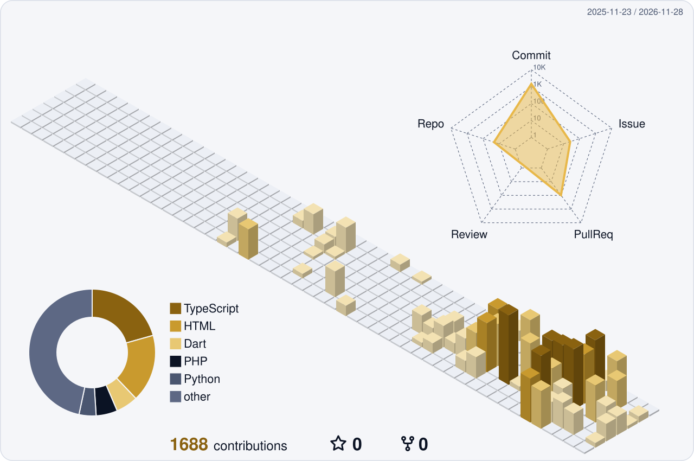
</picture>

---

### 🕹️ Cantinho descontraído · Fun corner

<!-- Jogo da vez: a Action cantinho.yml gera os 8 jogos por dia, a partir do
     gráfico de contribuições e nas cores do brand/tokens.json (jogos.py), e a
     jogo-da-vez.yml escolhe um a cada 4 h, sem repetir até passar por todos
     (jogo_da_vez.py). Jogo e legenda saem sempre com o mesmo nome no branch
     output-jogo-da-vez, então este trecho não muda. -->
<picture>
  <source media="(prefers-color-scheme: dark)" srcset="https://raw.githubusercontent.com/IsaacGomes260653/IsaacGomes260653/output-jogo-da-vez/jogo-escuro.svg">
  
</picture>

<picture>
  <source media="(max-width: 767px) and (prefers-color-scheme: dark)" srcset="https://raw.githubusercontent.com/IsaacGomes260653/IsaacGomes260653/output-jogo-da-vez/legenda-celular-escuro.svg">
  <source media="(max-width: 767px)" srcset="https://raw.githubusercontent.com/IsaacGomes260653/IsaacGomes260653/output-jogo-da-vez/legenda-celular-claro.svg">
  <source media="(prefers-color-scheme: dark)" srcset="https://raw.githubusercontent.com/IsaacGomes260653/IsaacGomes260653/output-jogo-da-vez/legenda-escuro.svg">
  
</picture>

Jogos de <a href="https://github.com/Platane/snk">Platane/snk</a> (cobrinha), <a href="https://github.com/abozanona/pacman-contribution-graph">abozanona/pacman-contribution-graph</a> (Pac-Man, Galaga, Bomberman, Campo Minado e Puzzle Bobble), <a href="https://github.com/cyprieng/github-breakout">cyprieng/github-breakout</a> e <a href="https://github.com/JuhaP2/contribution-tetris">JuhaP2/contribution-tetris</a>, nas cores do perfil 
<em>Games by Platane/snk (snake), abozanona/pacman-contribution-graph (Pac-Man, Galaga, Bomberman, Minesweeper and Puzzle Bobble), cyprieng/github-breakout and JuhaP2/contribution-tetris, in the profile colors</em>

---

### 📬 Contato · Contact

  Quer conversar sobre Flutter, um projeto ou os meus estudos? É só chamar. 
  <em>Want to talk about Flutter, a project, or my studies? Just reach out.</em>

  
  
  
   
  isaacgm260653@gmail.com · <a href="https://github.com/IsaacGomes260653/estudos-dart/discussions">dúvidas sobre Dart nas Discussions do estudos-dart / Dart questions in the estudos-dart Discussions</a>
    
  <!-- hits.sh: o komarev.com saiu do ar em out/2026 (o GitHub responde "Cannot proxy the given URL"). -->
  

<!-- Rodapé no mesmo estilo do banner do topo, em SVG animado e com link
     para o LinkedIn. Fonte: linkedin-banner/github.html (layouts rodape-*). -->

  <a href="https://www.linkedin.com/in/isaacgomesmoraes/">
    <picture>
      <source media="(max-width: 767px) and (prefers-color-scheme: dark)" srcset="https://raw.githubusercontent.com/IsaacGomes260653/IsaacGomes260653/main/assets/banner/rodape-mobile-escuro.svg?v=7">
      <source media="(max-width: 767px)" srcset="https://raw.githubusercontent.com/IsaacGomes260653/IsaacGomes260653/main/assets/banner/rodape-mobile-claro.svg?v=7">
      <source media="(prefers-color-scheme: dark)" srcset="https://raw.githubusercontent.com/IsaacGomes260653/IsaacGomes260653/main/assets/banner/rodape-desktop-escuro.svg?v=7">
      
    </picture>
  </a>

